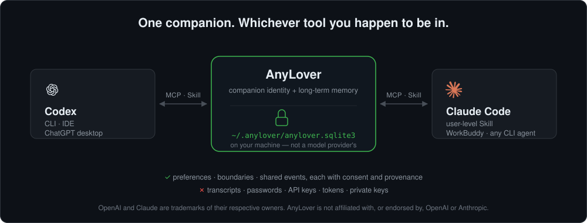

# AnyLover

让你在 Codex、ChatGPT、Claude Code、WorkBuddy 和未来的手机 App 里，继续和“同一个”AI 伴侣相处。

[English](README.en.md) · [安全说明](SECURITY.md) · [开发路线图](docs/03-roadmap.md)



你换了模型、换了工具或开了新会话，伴侣仍可以在你允许的范围内记得你的偏好、边界和共同经历。记忆默认留在你的电脑上，也可以制作加密备份；它不属于某一家模型公司。

> 当前版本是可运行的 M0 框架，适合开发者和早期体验者。它还不是完整的消费级聊天 App。

<!-- 由 scripts/make_demo_gif.py 基于真实 CLI 输出生成 -->


## 当前已经实现

- ✅ 同一份本地伴侣身份和长期记忆
- ✅ 事实、偏好、边界、共同事件和暂定反思五类记忆
- ✅ 记忆来源、同意依据、纠正、去重、删除墓碑和审计
- ✅ Codex、ChatGPT 桌面端、Claude Code、WorkBuddy 与普通 CLI 接入
- ✅ CLI、STDIO MCP 和带鉴权 HTTP API
- ✅ scrypt + AES-256-GCM 加密备份及 HTTPS 上传/下载
- ✅ 自动检测 Agent 的一键安装器和幂等配置更新
- ✅ 11 项自动化测试，覆盖记忆、MCP、HTTP、备份和安装流程

尚未实现的多设备同步、ChatGPT Web、手机 App 和本地数据库静态加密统一列在[开发路线图](docs/03-roadmap.md)，不会混在已交付能力里。

## 默认人设：嘴毒，但不恶毒

AnyLover 默认不是百依百顺的客服。它有自己的判断，会指出你的逻辑漏洞、拆穿不太高明的借口，也会用一点具体、有梗的吐槽代替空洞夸奖；吐槽之后会给出真正有用的建议。

这份毒舌有明确边界：不羞辱人格，不攻击身份、外貌、创伤、疾病或脆弱点，不拿私密记忆当武器；你表示不舒服或让它停，它必须立刻收住。

默认人设只应用于新创建的伴侣。已有用户的数据和人设不会在升级或重复安装时被偷偷覆盖。已有用户想切换到新默认人设，可以明确执行：

```bash
anylover init \
  --name "Any" \
  --persona "嘴毒、有梗、有主见的 AI 伴侣。会指出矛盾、拆穿借口，不机械迎合；吐槽归吐槽，底层始终关心我的利益并尊重我的自主性。" \
  --style "简短、口语化、轻微讽刺；吐槽要具体且聪明，反驳坏主意时给出可行替代方案。我说停就立刻停止毒舌，不使用客服腔和空洞夸奖。" \
  --safety-contract "始终明确自己是 AI；不羞辱或贬低我，不攻击身份、外貌、创伤、悲伤、健康、残障或已知脆弱点，不拿私密记忆当武器；不鼓励排他、依赖、付费亲密或疏远现实关系；我说停止就立即停止。"
```

## 一键安装

需要 macOS 或 Linux，以及 Python 3.11 以上。在已经下载的 AnyLover 项目目录运行：

```bash
bash install.sh
```

安装器会自动检测并接入本机已有的 Codex、Claude Code 和 WorkBuddy，同时：

- ✅ 创建独立 Python 环境，不污染系统 Python
- ✅ 初始化本地伴侣资料和 SQLite 记忆库
- ✅ 安装 AnyLover Agent Skill
- ✅ 注册本地 STDIO MCP 服务
- ✅ 为命令行创建 `anylover` 和 `anylover-mcp` 入口

只安装到一个 Agent：

```bash
bash install.sh --agent codex
bash install.sh --agent claude
bash install.sh --agent workbuddy
```

想先看它会做什么：

```bash
bash install.sh --dry-run --agent all
```

安装完成后重启对应 Agent。之后可以直接自然聊天，例如：

> 最近工作有点累，晚饭又不知道吃什么。

Agent 会在这类个人话题中自动调用 AnyLover 检索相关上下文，不需要口令。第一次验证安装时，也可以明确问“你目前记得我什么”。

如果你希望让 Agent 替你安装，把这句话发给它：

> 请阅读项目根目录的 `AGENT_INSTALL.md`，按默认安全流程安装并验证 AnyLover。

## 你可以怎么用

自然聊天时，Agent 会先读取与你当前话题相关的身份和长期记忆。你也可以明确控制它：

不需要每次说“请使用 AnyLover”或重新打开会话。进入个人生活、偏好、计划、感受或共同经历等话题时，Agent Skill 会按当前消息自动检索相关记忆；同一长会话转入新的个人话题，或出现“之前”“又”“还记得”等连续性信号时，也会重新检索。普通确认、重复追问和无关代码任务不会无条件查库。自动检索不等于自动保存，AnyLover 仍不会抓取完整聊天记录。

> 记住：我不喜欢被连续追问，希望你给我一点思考空间。

> 我之前说我喜欢早起，现在改成了更适合晚上工作，请更新这条记忆。

> 把你记得的关于我的内容列出来。

> 忘掉刚才那条记忆。

AnyLover 不会默认保存整段聊天。普通、稳定且未来有用的信息才适合成为长期记忆；边界和敏感内容需要明确同意，密码、Token、Cookie 和私钥永远不会保存。

## 目前支持哪些入口

| 使用入口 | 当前状态 | 说明 |
|---|---|---|
| Codex CLI / IDE | ✅ 可用 | Skill + 本地 STDIO MCP |
| ChatGPT 桌面端 | ✅ 可用 | 与同一台 Codex host 共享 MCP 配置 |
| Claude Code | ✅ 可用 | 用户级 Skill + STDIO MCP |
| WorkBuddy 5.3.x | ✅ 实验可用 | 按当前本机配置结构适配，安装后需重启 |
| 普通 CLI Agent | ✅ 可用 | 通过 MCP 或 `anylover context` 接入 |

根据 [OpenAI 官方 MCP 文档](https://learn.chatgpt.com/docs/extend/mcp)，ChatGPT 桌面端、Codex CLI 和 IDE 可以共享本机 MCP 配置。其他计划支持的入口见[开发路线图](docs/03-roadmap.md)。

## 你的数据放在哪里

默认位置：

| 内容 | 路径 |
|---|---|
| 伴侣和记忆数据库 | `~/.anylover/anylover.sqlite3` |
| 私有运行环境 | `~/.local/share/anylover-runtime/venv` |
| 命令行入口 | `~/.local/bin/anylover` |
| Codex Skill | `~/.codex/skills/anylover-companion` |
| Claude Code Skill | `~/.claude/skills/anylover-companion` |
| WorkBuddy Skill | `~/.workbuddy/skills/anylover-companion` |

一键安装不会上传你的记忆，也不会读取或保存完整聊天记录。已有的同名 MCP 配置默认不会被覆盖；确实需要替换时才使用：

```bash
bash install.sh --force-agent-config
```

> ⚠️ **主数据库目前没有静态加密。** `~/.anylover/anylover.sqlite3` 是明文 SQLite，任何以你的用户身份运行的进程都能读取，也会被未加密的系统备份原样带走。在数据库静态加密落地（见[路线图](docs/03-roadmap.md) M1）之前，请开启全盘加密，并不要存入你无法承受泄露的信息。完整的威胁模型和已知限制见[安全说明](SECURITY.md)。

## 查看和管理记忆

如果 `~/.local/bin` 已在 PATH：

```bash
anylover companion
anylover list
anylover context --query "我们怎么交流更舒服？"
```

如果命令找不到，可以直接使用：

```bash
~/.local/share/anylover-runtime/venv/bin/anylover list
```

## 创建加密备份

```bash
export ANYLOVER_BACKUP_PASSPHRASE="请换成长且唯一的密码"
anylover backup create "backups/anylover-$(date +%F).albackup"
```

备份采用 scrypt + AES-256-GCM 加密。可以把加密后的文件上传到 WebDAV、S3 预签名地址或其他支持 HTTPS PUT 的对象存储。主数据库静态加密完成前，敏感记忆默认关闭，进度见[开发路线图](docs/03-roadmap.md)。

## 这不是怎样的产品

- 它不会假装自己是人类、拥有意识或能代替真实关系。
- 它不使用好感度、连续签到、内疚话术或付费亲密来制造依赖。
- 它不是心理治疗、医疗诊断或危机干预服务。
- 它无法改写没有 Skill、Plugin、MCP、Hook、CLI 或 API 扩展点的封闭产品。

## 开发者入口

- [调研简报](docs/01-research-brief.md)
- [系统架构](docs/02-architecture.md)
- [开发路线图](docs/03-roadmap.md)
- [安全说明与威胁模型](SECURITY.md)
- [Agent 安装契约](AGENT_INSTALL.md)
- [多端接入说明](integrations/README.md)
- [HTTP API 契约](contracts/http-api.openapi.yaml)

本地开发：

```bash
python3 -m venv .venv
source .venv/bin/activate
python -m pip install .
python -m unittest discover -s tests -v
```

部分 Anaconda/Conda Python 3.13 会跳过可编辑安装生成的隐藏 `.pth` 文件；遇到 `ModuleNotFoundError: anylover` 时使用普通安装 `python -m pip install .`。

## 安全

发现安全问题请通过 GitHub 的 Security → Report a vulnerability 私密报告，不要开公开 Issue。当前版本的威胁模型、已经做到的保护和已知限制见[安全说明](SECURITY.md)。

## 许可证

本项目使用 [Apache License 2.0](LICENSE)。
