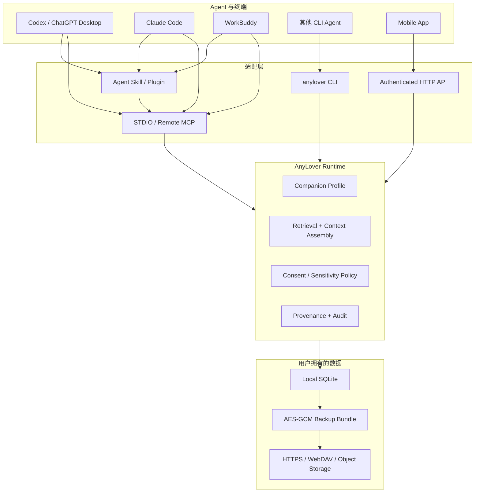

# AnyLover M0 架构

## 核心判断

“同一个伴侣”必须由独立运行时持有，而不是依赖某个模型的聊天历史。一个接入面包含两条通道：

- 行为通道：Skill/Plugin/系统指令，规定身份、语气、边界和何时使用记忆。
- 状态通道：MCP/HTTP/CLI，负责读取、写入、更正、删除和备份用户拥有的数据。

## 数据层次

| 层 | 当前实现 | 规则 |
|---|---|---|
| Companion identity | 名称、persona、表达风格、安全契约 | 跨模型稳定；不能伪装成人类 |
| Boundary | 用户明确边界 | 上下文中优先；必须 explicit consent |
| Preference | 稳定偏好 | 可纠正、可替代、可删除 |
| Fact | 用户身份与生活事实 | 带来源、时间和敏感级别 |
| Event | 共同经历 | 不默认保存完整原文 |
| Reflection | 对关系/模式的暂定归纳 | 明示 tentative，使用前应验证 |

M0 不持久化“伴侣当前情绪分数”或“好感度”。这类数值既容易制造虚假确定性，也容易被商业留存机制滥用。短时对话状态应留在会话上下文；只有用户认可的长期变化才进入记忆。

## 记忆生命周期

1. Agent 或移动端先读取相关上下文。
2. 写入时提交 `kind`、`sensitivity`、`consent_basis` 和 `source_surface`。
3. 服务端拒绝 secret；默认拒绝 sensitive；boundary 必须 explicit。
4. 完全相同的活跃记忆去重，更新信息可通过 `supersedes_id` 替代旧记录。
5. 删除会清除正文与 metadata，仅保留 tombstone，方便未来向其他设备传播删除。
6. 检索把 boundary 放在首位，再综合词面相关性、重要性、时间和访问次数。

## 安全与备份

- 数据目录权限尝试设置为 `0700`，数据库和备份设置为 `0600`。
- SQLite 目前不是 SQLCipher，敏感信息默认关闭；这是 M0 的明确限制。
- 备份使用 scrypt 派生 256-bit 密钥，再用 AES-256-GCM 加密完整、一致的 SQLite snapshot。
- 密码只从环境变量读取，不进入命令参数、日志或备份头。
- 上传发生在加密之后；云提供商只看到 ciphertext。
- 非 loopback HTTP 监听必须配置 Bearer token。生产远程网关还需 TLS、速率限制、设备撤销和每用户密钥。

## 兼容级别

| 端 | M0 | 限制 |
|---|---|---|
| Codex CLI/IDE/桌面 | STDIO MCP + Skill + Plugin scaffold | 需先安装 `anylover` 包 |
| ChatGPT Web | 契约已定义 | 需 M2 远程 MCP 与插件部署 |
| Claude Code | `.mcp.json` + Agent Skill | 项目配置首次使用可能需要信任确认 |
| WorkBuddy 5.3.5 | MCP JSON 样例 + Skill 内容 | 基于本机结构验证，需做真实会话兼容测试 |
| 其他 CLI Agent | `anylover context --json` 或 MCP | 取决于该工具能否注入上下文/调用工具 |
| Mobile | HTTP API | 尚无 iOS/Android UI 与设备密钥管理 |

## 与 ZifaMem 的关系

当前本机 ZifaMem alpha SDK 已提供 L1–L4、情绪信号、证据约束提取、JSON 本地存储和 prompt context。AnyLover 不复制其研究算法：AnyLover 负责跨端身份、同意、SQLite、删除、审计、MCP/API 和备份；M1 可以把 ZifaMem 作为可选 `MemoryEngine`，替换 M0 的确定性检索/提取，同时保持传输和数据所有权不变。

